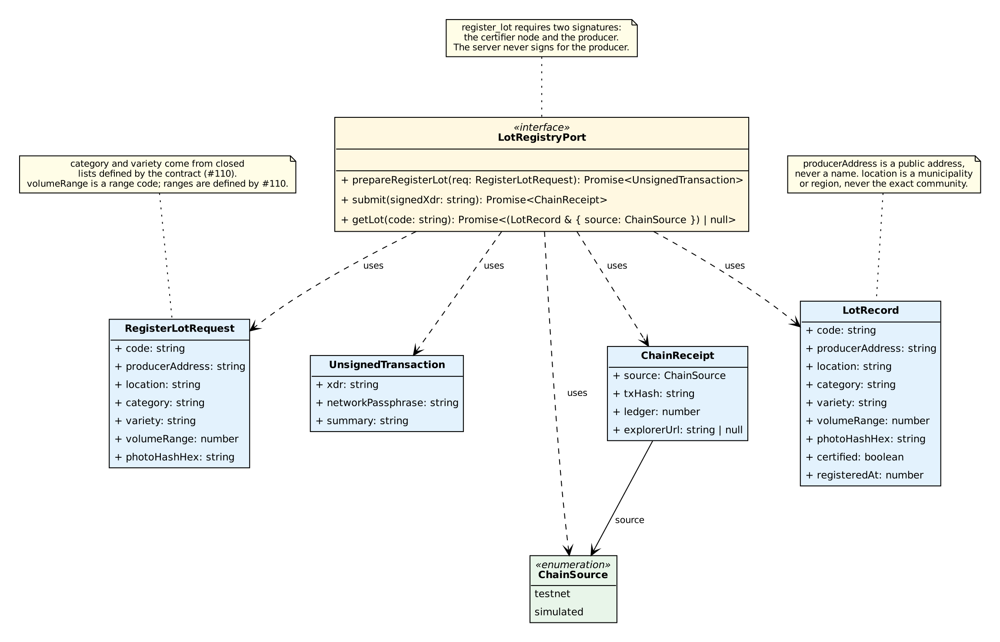

# Class diagram: lot registry

This diagram shows the lot registry port (`LotRegistryPort`) and the data it exchanges. The port has three operations: prepare an unsigned `register_lot` transaction, submit the signed one, and read a lot by its code.
It also shows the types used in those operations: the request (`RegisterLotRequest`), the stored record (`LotRecord`), the unsigned transaction (`UnsignedTransaction`), the receipt (`ChainReceipt`) and where a result comes from (`ChainSource`).
Only what is defined in the source file is drawn; the rest is written as notes.

## Elements

| Element | Kind | Description |
|---|---|---|
| `LotRegistryPort` | interface | Port for registering and reading lots. |
| `prepareRegisterLot(req: RegisterLotRequest): Promise<UnsignedTransaction>` | method of `LotRegistryPort` | Prepares the transaction without signing it. |
| `submit(signedXdr: string): Promise<ChainReceipt>` | method of `LotRegistryPort` | Sends the signed transaction. |
| `getLot(code: string): Promise<(LotRecord & { source: ChainSource }) \| null>` | method of `LotRegistryPort` | Reads a lot by its code. |
| `RegisterLotRequest` | class (interface in code) | Data needed to register a lot. |
| `code: string` | attribute of `RegisterLotRequest` | Lot code. |
| `producerAddress: string` | attribute of `RegisterLotRequest` | Public address of the producer. |
| `location: string` | attribute of `RegisterLotRequest` | Municipality or region. |
| `category: string` | attribute of `RegisterLotRequest` | From a closed list defined by the contract (#110). |
| `variety: string` | attribute of `RegisterLotRequest` | From a closed list defined by the contract (#110). |
| `volumeRange: number` | attribute of `RegisterLotRequest` | Volume range code; ranges are defined by #110. |
| `photoHashHex: string` | attribute of `RegisterLotRequest` | SHA-256 in hexadecimal of the product photo. |
| `LotRecord` | class (interface in code) | Registered lot as stored. |
| `code: string` | attribute of `LotRecord` | Lot code. |
| `producerAddress: string` | attribute of `LotRecord` | Public address of the producer. |
| `location: string` | attribute of `LotRecord` | Municipality or region. |
| `category: string` | attribute of `LotRecord` | Lot category. |
| `variety: string` | attribute of `LotRecord` | Lot variety. |
| `volumeRange: number` | attribute of `LotRecord` | Volume range code. |
| `photoHashHex: string` | attribute of `LotRecord` | Allows checking that the photo shown is the one registered. |
| `certified: boolean` | attribute of `LotRecord` | `false` if never certified or if the certification was revoked (#110). |
| `registeredAt: number` | attribute of `LotRecord` | Registration time. |
| `UnsignedTransaction` | class (interface in code) | Prepared transaction, not yet signed. |
| `xdr: string` | attribute of `UnsignedTransaction` | Transaction in base64 XDR. |
| `networkPassphrase: string` | attribute of `UnsignedTransaction` | Network passphrase. |
| `summary: string` | attribute of `UnsignedTransaction` | Plain-language text of what the person is about to sign. |
| `ChainReceipt` | class (interface in code) | Receipt of a transaction sent to the network (or simulated). |
| `source: ChainSource` | attribute of `ChainReceipt` | Where the result comes from. |
| `txHash: string` | attribute of `ChainReceipt` | Transaction hash. |
| `ledger: number` | attribute of `ChainReceipt` | Ledger number. |
| `explorerUrl: string \| null` | attribute of `ChainReceipt` | Explorer link, or `null` if simulated. |
| `ChainSource` | enumeration (type union in code) | Origin of a result. |
| `testnet` | value of `ChainSource` | Result from the test network. |
| `simulated` | value of `ChainSource` | Simulated result (the UI shows `<DemoBadge />`). |

## Sources

- [`src/core/chain/ports.ts`](../../src/core/chain/ports.ts)
